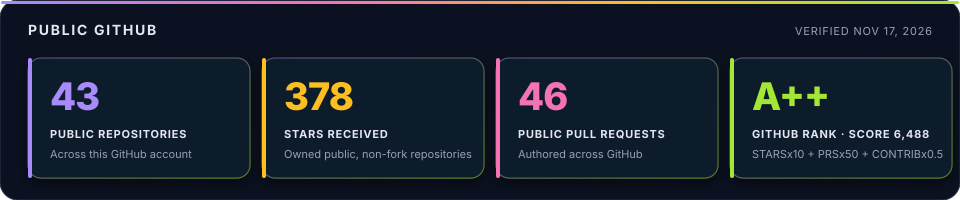

 

   

 

### 🔴 $\color{#FF4444}{\textsf{About Me}}$

- 🔴 $\color{#FF4444}{\textsf{\textbf{Applied AI \& Cloud Engineer}}}$ — $\color{#FF4444}{\textsf{Specializing in LLM cost optimization, responsible AI, and scalable cloud deployments.}}$
- 🔴 $\color{#FF4444}{\textsf{\textbf{Google Gemini Student Ambassador}}}$ — $\color{#FF4444}{\textsf{Leading developer workshops and applied generative AI sessions with Google India.}}$
- 🔴 $\color{#FF4444}{\textsf{\textbf{AWS Certified Solutions Architect}}}$ — $\color{#FF4444}{\textsf{Designing containerized cloud infrastructure across GCP, AWS, Docker, and CI/CD pipelines.}}$
- 🔴 $\color{#FF4444}{\textsf{\textbf{4 Deployed AI Products}}}$ — $\color{#FF4444}{\textsf{Built TokenFlow AI (~40\% token savings benchmark) and BiasGuard AI (fairness auditor).}}$
- 🔴 $\color{#FF4444}{\textsf{\textbf{13+ Hackathons \& Global Recognitions}}}$ — $\color{#FF4444}{\textsf{PromptWars Top 400 and Google Solution Challenge 2026 solo builder.}}$

 

## GitHub activity

  

  

  

