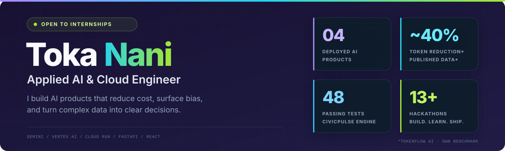
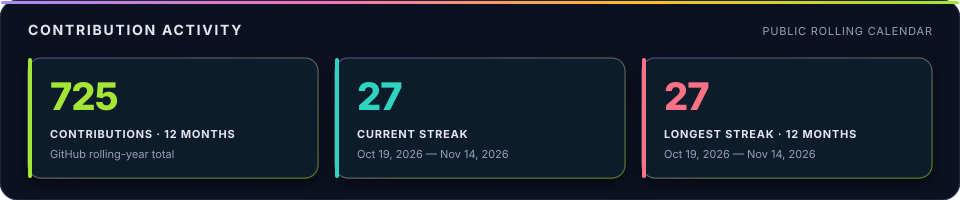
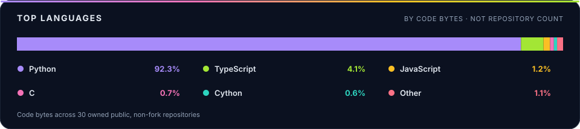
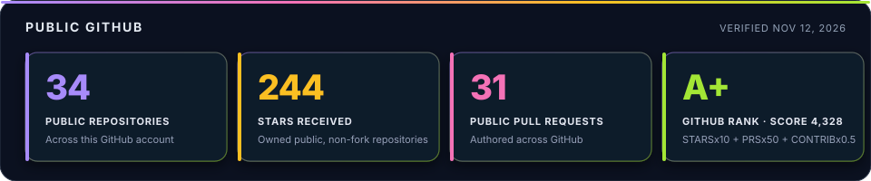

 

   

**[Selected work](#selected-work) · [Experience](#experience--recognition) · [Technical toolkit](#technical-toolkit) · [Contact](#lets-build-something-useful)**

## AI that ships. Cloud that scales. Results you can measure.

I’m **Toka Nani**, an Applied AI and Cloud Engineer who takes products from idea to deployment—not just to a notebook. My work spans **LLM cost optimization, responsible AI, and multilingual decision systems**, using Python, FastAPI, React, Docker, and Google Cloud.

**Google Gemini Student Ambassador · AWS Certified Solutions Architect – Associate · B.Tech CSE ’28**

| Applied AI engineering | Cloud & platform engineering | Product engineering |
|---|---|---|
| Gemini, Vertex AI, embeddings, fairness metrics, and evaluation-driven LLM workflows. | Containerized services, Cloud Run, Firestore, Cloud Storage, and CI/CD with GitHub Actions. | React and TypeScript interfaces backed by tested Python APIs and practical data pipelines. |

> **Currently seeking:** Software Engineering, Applied AI, Cloud, and DevOps internships. Open to remote work and relocation. Based in India · UTC+5:30.

---

## Selected work

### 01 / TokenFlow AI — making LLM context cheaper

**The problem:** Repeated prompt context increases token usage and makes LLM applications more expensive to operate.

**What I built:** Middleware that combines Gemini `text-embedding-004` vectors with exponential recency-decay compression before each completion call.

**Measured result:** **~74% less prompt-token overhead** in my own benchmark.

`FastAPI` `Gemini 1.5 Flash` `Embeddings` `React 18` `Render`

[**Live product**](https://tokenflow-ai.onrender.com) · [**API documentation**](https://tokenflow-ai.onrender.com/docs) · [**Source code**](https://github.com/NaniToka/TokenFlow-AI)

---

### 02 / BiasGuard AI — making automated decisions auditable

**The problem:** Hiring and credit-scoring systems can produce inequitable outcomes without a clear, reviewable audit trail.

**What I built:** A forensic auditing pipeline that streams decision logs through demographic-parity and equalized-odds checks, then uses Gemini to generate compliance reports mapped to UN SDG-5 and SDG-10.

**Measured result:** Compliance reports generated in **under 30 seconds**. Designed and built solo for Google Solution Challenge 2026.

`Vertex AI` `Gemini` `Flask` `Firestore` `Cloud Run` `Docker`

`Decision logs → Cloud Storage → Flask on Cloud Run → Fairness evaluation → Gemini report → Firestore audit trail`

[**Source code & architecture**](https://github.com/NaniToka/unbiased-ai-decision)

---

### 03 / CivicPulse AI — turning citizen complaints into ranked action

**What I built:** A multilingual civic decision-intelligence platform. Gemini detects language and categorizes complaints; a deterministic four-factor scoring engine ranks demand, infrastructure gaps, vulnerability, and investment overlap.

**Engineering proof:** **37 passing pytest tests** for the scoring engine.

`FastAPI` `React` `TypeScript` `Vite` `Gemini`

[**Live product**](https://civicpulse-ai-frontend.onrender.com/) · [**Source code**](https://github.com/NaniToka/civicpulse-ai)

---

### 04 / VoteWise AI — helping first-time voters prepare

**What I built:** A nonpartisan voter-readiness assistant combining a deterministic decision-tree engine with Gemini-powered Q&A, containerized and deployed on Cloud Run for PromptWars.

`React` `TypeScript` `Gemini` `Docker` `Cloud Run`

[**Source code**](https://github.com/NaniToka/votewise-ai)

<strong>More engineering work</strong>

 

- **Mutual Fund Analytics Platform — Bluestock capstone:** Nine-table SQLite star schema with 86,000+ rows; CAGR, Sharpe, Sortino, Alpha-Beta, VaR, and CVaR analytics in a four-page Streamlit dashboard. [**Source code**](https://github.com/NaniToka/bluestock-mf-capstone)
- **JanVoice AI:** Role-based grievance portals for citizens, MPs, and administrators, with Gemini-generated daily constituency briefings. [**Live product**](https://spontaneous-raindrop-8a7198.netlify.app/dashboard)

---

## Experience & recognition

| Timeline | Role or milestone | What it demonstrates |
|---|---|---|
| **May 2026 — Present** | **Google Gemini Student Ambassador**, Google India | Leading AI workshops and developer sessions; communicating technical concepts to campus communities. |
| **Sep — Oct 2026** | **Data Analyst Intern**, Bluestock Fintech | Built an end-to-end mutual-fund analytics pipeline with live AMFI NAV integration. |
| **2026** | **Google Solution Challenge** | Designed and shipped BiasGuard AI as a solo builder. |
| **2026** | **PromptWars Virtual, Challenge 3** | Placed in the **Top 400**. |
| **2026** | **Anvil @ Ascent**, Scaler School of Technology | **Grand Finale qualifier**. |

**Professional simulations:** JPMorgan Software Engineering · Walmart Global Tech Advanced SWE · Tata iQ GenAI Analytics.

<strong>Certifications & credentials</strong>

 

| Certification | Issuer | Verification |
|---|---|---|
| AWS Solutions Architect – Associate | AWS | [Verify credential](https://www.credly.com/badges/24807f2f-d801-4f20-9c7e-ab40c2fa6b35/linked_in_profile) |
| Google AI Essentials | Google / Coursera | [Verify credential](https://www.coursera.org/account/accomplishments/specialization/HAXF8PBC6D2I) |
| Claude Code in Action | Anthropic | [Verify credential](https://verify.skilljar.com/c/e8sdwwdwxw78) |
| Google Cloud Gen AI Academy APAC, Cohort 3 | Google Cloud × Hack2skill | [Verify credential](https://certificate.hack2skill.com/verify/2026H2S09GCGENAIAPACC3-P00601) |
| Amrita Agentic Leap 2026 | Amrita Vishwa Vidyapeetham | [Verify credential](https://certificate.amritauniversity.in/verify/359876) |
| Build with AI Bootcamp, Chennai | Google for Developers | [Verify credential](https://certificate.hack2skill.com/verify/2026H2S08BWAICHN-P00569) |
| Google Solution Challenge 2026 | Google × Hack2skill | [Verify credential](https://certificate.hack2skill.com/verify/2026H2S07SCBWAI-PS06834) |
| PromptWars Virtual, Challenge 1 | Google for Developers | [Verify credential](https://certificate.hack2skill.com/verify/2026H2S04PWVCHL1-A00285) |

---

## Technical toolkit

| Capability | Tools |
|---|---|
| **AI & ML** | Gemini API · Vertex AI · embeddings · prompt engineering · fairness metrics |
| **Languages** | Python · TypeScript · JavaScript · SQL |
| **Backend & data** | FastAPI · Flask · Node.js · Pandas · SQLAlchemy · SQLite · Streamlit |
| **Frontend** | React · Vite · Tailwind CSS |
| **Cloud & DevOps** | Google Cloud Run · Cloud Storage · Firestore · Docker · Render · GitHub Actions · Git |

### How I approach engineering

1. **Start with the decision or user outcome**, not the model.
2. **Keep critical logic deterministic and tested**; use AI where it adds clear value.
3. **Deploy early and instrument the result**—cost, latency, quality, or fairness.
4. **Make the system understandable** through documentation, audit trails, and usable interfaces.

<strong>GitHub activity</strong>

 

  
    
  
    
  

---

## Let’s build something useful

**Have a challenging problem in AI, cloud, data, or developer tooling? I’d love to hear about it.**

Open to immediate internship opportunities · Remote or relocation · Vijayawada, India

 

   

 

