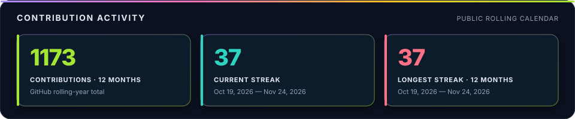
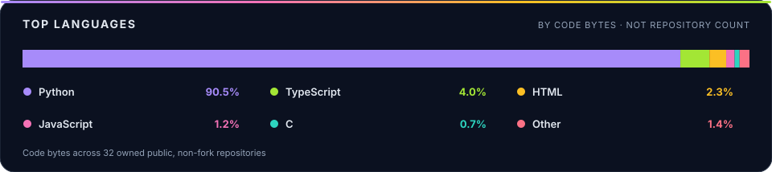

 

   

 

### About Me

- 🚀 **Cloud and GenAI Developer** building production-oriented AI applications with Python, TypeScript, FastAPI, React, and Google Cloud.
- 🎓 B.Tech CSE (2024–2028), DVR and Dr. HS MIC College of Technology, Vijayawada.
- 🟡 **Google Gemini Student Ambassador** (May 2026 – present) — leading workshops and developer sessions on AI application development.
- ☁️ **AWS Certified Solutions Architect – Associate** — designing scalable cloud infrastructure across AWS, GCP, Docker, and CI/CD.
- 🔬 **CivicPulse AI** — multilingual civic decision-intelligence platform with 48 passing pytest tests (React, TypeScript, FastAPI, Gemini API).
- 📊 **Mutual Fund Analytics Platform** — 9-table SQLite star schema, 86,000+ rows, 4-page Streamlit dashboard (Bluestock Fintech internship).
- 💼 Currently seeking **Software Engineering, Cloud, and DevOps internships**. Open to remote and relocation.

 

## GitHub activity

  

  

  

